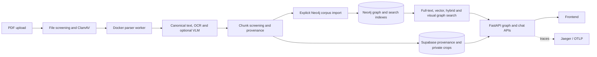

# Graph RAG

Graph RAG is a document-grounded question answering and knowledge graph
application for legal and enterprise risk documents. It ingests PDFs, preserves
source provenance, indexes admitted text in Neo4j, and serves text and image
evidence through a FastAPI backend.

> **Start here:** follow [setup.md](setup.md) for the complete Windows
> development setup, including Docker, the parser worker, ClamAV, Supabase,
> Neo4j, environment variables, and local startup.

## Capabilities

- PDF upload and batch ingestion with file screening, isolated Docker parsing,
  canonical text, OCR, optional OpenAI visual descriptions, and source-backed
  chunk provenance.
- Supabase persistence for ingestion provenance and private image crops.
- Neo4j structural corpus import, text/vector/hybrid retrieval, and graph
  retrieval for unverified visual observations.
- Document Q&A chat with shared conversation history, citations, and
  `risk_analysis` and `summarization` skills.
- Paginated graph export for frontend rendering and a private image endpoint
  that verifies the original crop hash before serving it.
- OpenTelemetry traces through an OTLP HTTP endpoint such as local Jaeger.

VLM descriptions and visual graph candidates remain explicitly AI-generated
observations. They are not treated as verified source facts or authoritative
legal conclusions. Retrieved quotations use raw source text; private asset
references do not expose public storage URLs.

## Architecture



PDF ingestion and Neo4j graph import are separate operations. The API's
`POST /ingestion` and `POST /ingestion/batch` perform document ingestion and
persist provenance when Supabase is configured. The explicit corpus CLI reads
the latest persisted output and imports it to Neo4j; the API does not silently
rebuild or replace the graph during startup.

## Quick start

Prerequisites include Python 3.14, `uv`, Docker Desktop, a Neo4j 2026.09+
database, and (for persisted ingestion/chat) a Supabase project. Configure the
required services in `.env` by following [setup.md](setup.md), then run:

```powershell
uv sync
uv run uvicorn src.api.main:app --host 127.0.0.1 --port 8000
```

Check liveness at <http://127.0.0.1:8000/health>, dependency readiness at
<http://127.0.0.1:8000/health/ready>, and interactive API documentation at
<http://127.0.0.1:8000/docs>.

### Frontend

In another PowerShell window, start the local frontend host:

```powershell
uv run uvicorn server:app --app-dir frontend --host 127.0.0.1 --port 3000
```

Open <http://127.0.0.1:3000>. The UI's **Live API** mode calls the Graph RAG
backend at `http://127.0.0.1:8000` by default. The frontend server also has
offline/demo routes with sample in-memory data; use Live API mode to work with
the configured ingestion, chat, retrieval, and Neo4j services. This local UI
host is a development aid, not a production deployment server.

## Main API routes

| Route                                     | Purpose                                                                     |
| ----------------------------------------- | --------------------------------------------------------------------------- |
| `POST /ingestion`                         | Ingest one PDF.                                                             |
| `POST /ingestion/batch`                   | Ingest up to 10 PDFs independently.                                         |
| `GET /graph`                              | Read a paginated graph snapshot for frontend rendering.                     |
| `POST /graph/search`                      | Retrieve and fuse text and image-derived graph evidence.                    |
| `GET /visual-assets/{run}/{page}/{block}` | Serve a hash-verified private image crop.                                   |
| `GET /chat/documents`                     | List fully ingested documents available to chat.                            |
| `POST /chat`                              | Ask a question in a persisted conversation; accepts an optional skill hint. |
| `/chat/conversations`                     | Create, list, load, rename, or delete conversations.                        |

The chat API returns structured citations alongside the answer. Conversations
share one thread across ordinary Q&A and skill use. The project currently has
no user authentication; run it only in a trusted local or appropriately
protected environment.

## Neo4j corpus and embeddings

Neo4j schema bootstrap and corpus import are explicit operations. The corpus
CLI defaults to dry-run; writing requires `--apply`. Inspect its options with:

```powershell
uv run python -m src.graph.corpus_cli --help
```

Embedding configuration must explicitly identify its provider, model, and
dimensions. The matching vector index is not silently created by API startup
or retrieval. Use `scripts/index_neo4j_embeddings.py` to index the configured
current corpus, and `scripts/retrieval_smoke.py` for read-only retrieval
checks. Do not change embedding spaces for a populated index without a planned
reindex.

## Source and graph model

Chunk `raw_text` remains the source for screening, quotations, and evidence.
`retrieval_text` is a derived search field with reversible edits; it is not
used as quoted evidence. Chunk sources retain document hash, ingestion run,
page, block, reading order, and text offsets. An ingestion upload and a graph
import are separate: inspect the corpus CLI in dry-run mode before enabling
`--apply`.

The graph supports enterprise concepts such as organizations, applications,
policies, obligations, controls, findings, risks, and evidence. Semantic claims
keep verifier attestations and source references; competing claims can be
classified as `SUPPORTS`, `CONTRADICTS`, `QUALIFIES`, `SUPERSEDES`, or
`UNRESOLVED`. Classification preserves disagreement; it does not determine
legal truth. Visual observations and entity candidates are kept separate and
marked unverified.

## Repository layout

- `src/api/` — FastAPI ingestion, graph, visual asset, and chat routes.
- `src/ingestion/` — parsing orchestration, canonicalization, OCR/VLM, chunking,
  and Supabase provenance.
- `src/graph/` — corpus loading, structural and semantic writers, retrieval,
  image-aware graph support, and chat agent.
- `frontend/` — local development UI and demo host.
- `supabase/setup.sql` — consolidated bootstrap for a fresh Supabase project.
- `scripts/` — explicit embedding, retrieval smoke, and visual knowledge tools.
- `artifacts/evaluation/` — frozen Phase 3 evaluation outputs.
